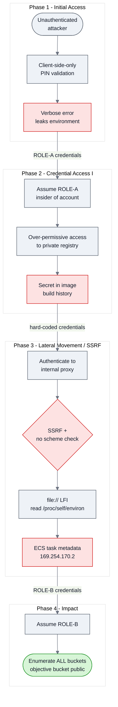

# AWS Attack Path: From an Exposed Serverless Endpoint to Account-Wide Storage Enumeration

> A hands-on cloud attack-path study with detection and remediation, performed against an intentionally vulnerable AWS lab (serverless + container workloads). Written as an engagement-style report, not a lab walkthrough.

| | |
|---|---|
| **Author** | ABManaf |
| **Discipline** | Offensive Security — Cloud Penetration Testing |
| **Assessment type** | Black-box attack-path assessment (attacker + defender perspectives) |
| **Target environment** | Intentionally vulnerable AWS training lab — serverless (Lambda) and container (ECS Fargate) workloads |
| **Report type** | Engagement-style technical write-up |
| **Date** | October 2026 |

> **Environment & attribution.** This exercise was performed against **flAWS2.cloud**, the public AWS security training lab by Scott Piper / Summit Route. The report explains the **techniques and root causes** at a conceptual level, but deliberately withholds the lab's **turn-key answers** — exact endpoint URLs, the PIN value, recovered credentials/passwords, specific resource and object names, and copy-paste exploit strings — so it reads as an analysis rather than a step-by-step solution. Account IDs, keys, tokens, and source IPs are replaced with placeholders (`TARGET_ACCOUNT`, `<ACCESS_KEY>`, `ATTACKER_IP`) as standard report hygiene.
>
> *If you plan to try flaws2.cloud yourself, attempt it before reading on.*

---

## 1. Executive summary

One unvalidated input to an internet-facing serverless function led — through a chain of misconfigurations — to theft of two separate sets of cloud credentials and the ability to enumerate every storage bucket in the account. The function validated input only in the user's browser; fed unexpected data, it returned its own runtime environment, including the credentials of the IAM role it runs as. Those credentials opened a private container registry left too permissive, and the image inside held a hard-coded password in its build history. That password unlocked an internal proxy vulnerable to Server-Side Request Forgery (SSRF); the attacker used it to read the container's environment and then query the cloud metadata service, stealing a second, broader set of credentials. With those, the attacker enumerated the account's storage.

**Demonstrated vs. inferred (scoped honestly):** the second role was proven to enumerate every bucket name in the account (`s3:ListAllMyBuckets`); the final objective bucket was readable because it was *itself public*. Contents-level read of *arbitrary* buckets using the stolen role was **not** separately validated and is **not** claimed.

Every weakness is a common, real-world cloud misconfiguration: client-side-only validation, verbose error handling, over-privileged roles, public resources, secrets baked into images, and SSRF reaching the metadata service — none requiring a software exploit, only trust placed in the wrong boundary. In a production environment the equivalent pattern leads to credential theft and data exfiltration. All issues are remediable with the configuration and least-privilege changes in [`remediation.md`](remediation.md).

---

## 2. Scope & methodology

| | |
|---|---|
| **Target** | Intentionally vulnerable AWS lab modelling a serverless + container application |
| **Accounts** | `TARGET_ACCOUNT` (victim application), `SECURITY_ACCOUNT` (logging / incident response) |
| **Approach** | Manual, AWS CLI + `curl` + `docker` + `jq`. No exploitation frameworks were used — every step is an explicit, explainable command so the IAM/authorization reasoning is visible. |
| **Perspective** | Both **attacker** (black-box, unauthenticated start) and **defender** (CloudTrail log analysis of the same attack) |
| **Rules** | Documentation only. No destructive actions. Credentials recovered during the lab were ephemeral and are redacted here. |

**Tools:** `aws-cli`, `curl`, `docker`, `jq`, and AWS Athena (concept) for log analysis.

**Note on tooling.** I worked manually on purpose, to keep the IAM/authorization reasoning visible. In a real engagement a framework such as **Pacu** would automate much of this — role/credential enumeration, permission and privilege-escalation path discovery, and bulk S3/ECR enumeration — reaching the same findings faster (e.g. `iam__enum_permissions`, `iam__privesc_scan`, `s3__download_bucket`). The trade-off is transparency: the manual path shows *why* each step works, which is the point of this write-up. Knowing both — the automated shortcut and the underlying mechanics — is the goal.

---

## 3. Attack path overview

The full chain, grouped by phase. See [`attack-path.md`](attack-path.md) for the narrative and phase mapping.



Two credential thefts, each from a different weakness, chained into account-wide storage enumeration.

---

## 4. Step-by-step technical narrative

Commands are shown redacted and generically; exact URLs, resource names, and credential values are omitted to avoid leaking lab answers.

### Step 1 — Recon: map the serverless backend
The entry point was a web form asking for a numeric code, with a note that brute force was futile (the value space was astronomically large). Reading the page source revealed the form submitted to an **API Gateway endpoint** backing a Lambda function, and that the only validation ("must be a number") ran **in client-side JavaScript**.

**Reasoning:** an unbreakable front-door secret is a signal to stop attacking the secret and attack the *infrastructure* behind it. Client-side validation is not a security control — it runs on the attacker's machine.

### Step 2 — Initial access: bypass validation, trigger a verbose error
Issuing the request **directly to the API** (bypassing the browser) with a value the function did not expect caused the function's error handler to return its **entire runtime environment** in the HTTP response. AWS injects a Lambda's execution-role credentials into environment variables, so the response contained:
```
AWS_ACCESS_KEY_ID = <ACCESS_KEY (ASIA… = temporary STS credentials)>
AWS_SECRET_ACCESS_KEY = <SECRET_KEY>
AWS_SESSION_TOKEN = <SESSION_TOKEN>
```
→ **Findings [F-01](findings/F-01-client-side-validation.md), [F-02](findings/F-02-sensitive-data-exposure-serverless.md).**

### Step 3 — Pivot: assume the function's role
Loading the leaked credentials and confirming identity:
```bash
aws sts get-caller-identity --profile role-a
# -> arn:aws:sts::TARGET_ACCOUNT:assumed-role/ROLE-A/...
```
The attacker is now an **insider of `TARGET_ACCOUNT`**, inheriting whatever `ROLE-A` can do.

### Step 4 — Enumeration: discover and pull a private container image
`ROLE-A` could not list *all* buckets (`s3:ListAllMyBuckets` denied) but **could** list a specific, named resource — and, critically, held **container-registry permissions it did not need**. The registry's repository policy was also over-permissive. Using the stolen identity:
```bash
aws ecr list-images --repository-name <REPO> --registry-id TARGET_ACCOUNT --region <REGION>
# authenticate + pull the private image
```
→ **Findings [F-03](findings/F-03-excessive-iam-permissions.md), [F-04](findings/F-04-public-container-registry.md).**

### Step 5 — Loot the image: recover a hard-coded secret
A container image carries its **build history**. Inspecting it exposed a basic-auth credential set in plaintext in a build instruction:
```bash
docker history --no-trunc <IMAGE>
# -> RUN htpasswd -b <path> <BASIC_AUTH_USER> <BASIC_AUTH_PASS>   (plaintext)
```
→ **Finding [F-05](findings/F-05-hardcoded-credentials-image.md).**

### Step 6 — Access the internal service, find SSRF
The recovered credentials unlocked an internal **proxy service** that fetched arbitrary URLs on the server side (SSRF). Reading the proxy's own source (recovered from the image) showed it passed user input straight into a URL-opening call **with no scheme restriction** — so `file://` worked, turning SSRF into **local file read (LFI)**.

### Step 7 — Steal the second credential set via the metadata service
Using `file://` to read `/proc/self/environ` revealed the container's environment, including the relative path to the **ECS task metadata credentials endpoint** (`169.254.170.2/...`). Requesting that path **through the SSRF** returned the **task role (`ROLE-B`) credentials**.
```bash
aws sts get-caller-identity --profile role-b
# -> arn:aws:sts::TARGET_ACCOUNT:assumed-role/ROLE-B/...
aws s3 ls --profile role-b        # ROLE-B could enumerate all buckets
```
→ **Findings [F-06](findings/F-06-ssrf-metadata-credential-theft.md), [F-07](findings/F-07-public-object-storage.md).**

### Step 8 (Defender) — Detect the attack in CloudTrail
Replaying the logs as an incident responder, the whole chain is visible. The decisive signal: **the same IAM role credentials appear from two different source IPs** — an AWS-internal address (legitimate execution) *and* an external internet address (`ATTACKER_IP`, the replayed stolen credentials). See [`detection.md`](detection.md).

---

## 5. Findings summary

| ID | Title | Severity | CWE | MITRE ATT&CK | Affected resource |
|----|-------|----------|-----|--------------|-------------------|
| [F-01](findings/F-01-client-side-validation.md) | Input validation enforced only client-side | Medium | CWE-602 | T1190 | Serverless API endpoint |
| [F-02](findings/F-02-sensitive-data-exposure-serverless.md) | Role credentials disclosed via verbose error handling | High | CWE-209 / CWE-526 | T1552 | Serverless function |
| [F-03](findings/F-03-excessive-iam-permissions.md) | Over-privileged function execution role | Contributing¹ | CWE-250 / CWE-269 | — | IAM role (ROLE-A) |
| [F-04](findings/F-04-public-container-registry.md) | Private container registry exposed to unauthorized principals | High | CWE-732 | T1530 (approx.)² | Container registry |
| [F-05](findings/F-05-hardcoded-credentials-image.md) | Hard-coded credentials embedded in container image | High | CWE-798 | T1552.001 | Container image |
| [F-06](findings/F-06-ssrf-metadata-credential-theft.md) | SSRF enabling file read and cloud-metadata credential theft | High (8.5) | CWE-918 | T1552.005 | Proxy service / IMDS |
| [F-07](findings/F-07-public-object-storage.md) | Publicly readable object storage | Medium | CWE-732 | T1530, T1619 | Object storage buckets |

> ¹ **Contributing** = a weakness that amplifies the chain but isn't independently exploitable, so it carries no standalone CVSS.
>
> ² **Approximate** = ATT&CK has no technique that precisely covers pulling an image from an exposed container registry (T1530 covers cloud *storage objects*; T1613 covers *in-cluster* container discovery). T1530 is listed as the nearest fit.
>
> CVSS v3.1 vectors are hand-computed and reconciled with each finding's score/label. CWE and MITRE ATT&CK IDs were verified against their official sources; where a mapping is inexact (F-02 uses the parent T1552 for an environment-variable leak; F-04 is marked approximate), that is stated explicitly.
>
> **Chain-level technique:** replaying each of the two stolen credential sets to act in the account maps to **T1078.004 — Valid Accounts: Cloud Accounts**; the account-wide bucket *enumeration* maps to **T1619 — Cloud Storage Object Discovery**.

---

## 6. Lessons learned

1. **Security boundaries must be enforced server-side.** Validation, authorization, and secrecy that depend on the client or on "nobody will guess this" collapse the moment the attacker talks to the backend directly.
2. **A workload's identity is the real prize.** Both pivots came from stealing the credentials of a *workload* (a function role, then a task role) — the cloud equivalent of stealing a service account. Protect where those credentials live (env vars, metadata service) as if they were passwords.
3. **Least privilege breaks chains.** The function role held registry permissions it never needed; removing them alone would have stopped the pivot to the image.
4. **Public is rarely necessary.** Every "open" resource (registry, buckets) was an unnecessary exposure that an attacker converted directly into access.
5. **SSRF is a cloud-critical bug class.** Reaching the metadata service through SSRF is the single highest-leverage web-to-cloud pivot (the pattern behind major real-world breaches).
6. **Detection hinges on identity context, not just actions.** The attack's cleanest signal was not *what* API calls happened but *that a role's credentials were used from outside its expected environment.*
