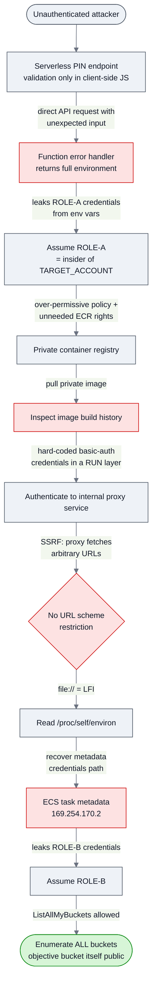

# Attack Path Diagram & Narrative

## Full chain

## Narrative (one paragraph)

The attack begins with an internet-facing serverless endpoint whose only input check runs in the browser. Submitting unexpected input straight to the API causes the function to leak its runtime environment — and with it, the temporary credentials of its execution role (**ROLE-A**). Those credentials make the attacker an insider of the target account, which is enough to reach a private container registry left open by an over-permissive policy (and reachable because the function role carried registry permissions it never needed). Pulling the image and reading its build history exposes a hard-coded password that unlocks an internal proxy. The proxy is vulnerable to SSRF and, because it applies no URL-scheme restriction, also to local file read; reading the container's environment reveals the path to the ECS task metadata service, which is then queried *through the SSRF* to steal a second, broader credential set (**ROLE-B**). ROLE-B can enumerate every bucket in the account (`s3:ListAllMyBuckets`); the objective bucket was then read because it was itself public. Account-wide *enumeration* was reached entirely through chained misconfigurations.

## Phase mapping (Cyber Kill Chain / cloud)

| Phase | Step in this engagement |
|-------|-------------------------|
| Reconnaissance | Fingerprint the serverless backend from page source |
| Initial Access | Bypass client-side validation; trigger verbose error |
| Credential Access (1) | Harvest ROLE-A creds from leaked environment |
| Discovery / Lateral Movement | Enumerate + pull private container image |
| Credential Access (2) | Recover hard-coded secret; SSRF → metadata → ROLE-B creds |
| Collection / Impact | Enumerate all buckets account-wide; read the (public) objective bucket |
