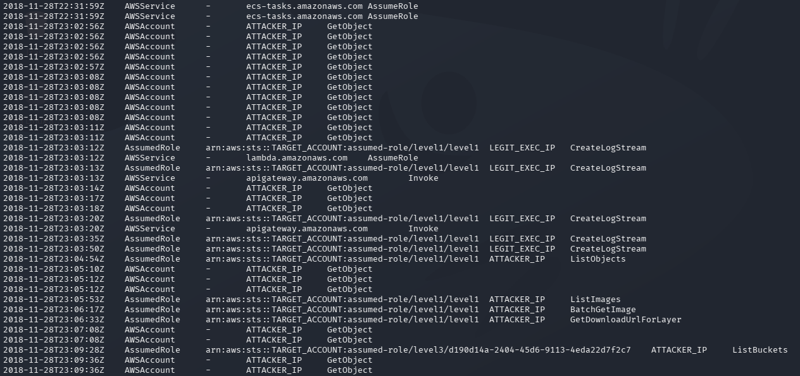

# Evidence

Redacted captures supporting this report. All AWS **account IDs, access/secret keys, session tokens, and source IPs** are replaced with placeholders (`TARGET_ACCOUNT`, `<ACCESS_KEY>`, `<SECRET_KEY>`, `<SESSION_TOKEN>`, `ATTACKER_IP`, `LEGIT_EXEC_IP`). Original unredacted captures are kept out of git.

## 1. Serverless environment-variable credential leak — Finding [F-02](../findings/F-02-sensitive-data-exposure-serverless.md)

Sending unexpected input to the internet-facing serverless endpoint makes the function's error handler return its **entire runtime environment** — including the execution role's temporary credentials (masked below).

## 2. Defender — CloudTrail timeline of the intrusion — see [`detection.md`](../detection.md)

The decisive signal: the **same `level1` role** appears both from its legitimate execution address (`LEGIT_EXEC_IP`, `CreateLogStream`) **and** from an external `ATTACKER_IP` performing S3/ECR actions (`ListObjects`, `ListImages`, `BatchGetImage`, `GetDownloadUrlForLayer`) — i.e. stolen credentials replayed from outside AWS. The `level3` role then lists buckets from the same attacker IP.

---

*Adding new captures? Redact account IDs, keys, tokens, source IPs, full ARNs, and any lab-answer values first (prefer masking in-terminal with `sed`/`jq` over blurring the image). Keep originals in a local `raw-evidence/` folder — it is already git-ignored.*
