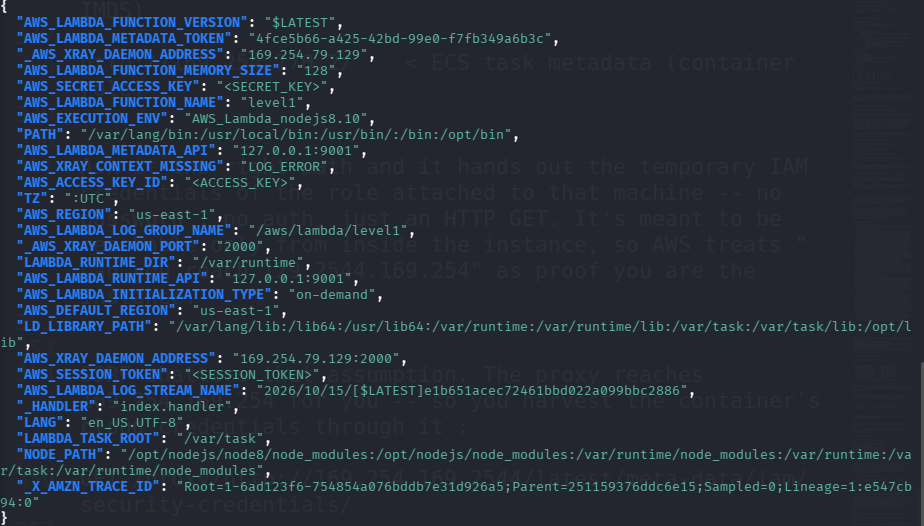

# F-02 — IAM role credentials disclosed via verbose error handling

| | |
|---|---|
| **Severity** | High |
| **CVSS v3.1** | `AV:N/AC:L/PR:N/UI:N/S:C/C:H/I:N/A:N` → **8.6** |
| **CWE** | CWE-209: Generation of Error Message Containing Sensitive Information; CWE-526: Cleartext Storage of Sensitive Information in an Environment Variable |
| **MITRE ATT&CK** | T1552 — Unsecured Credentials (parent technique; the credentials were exposed via *environment variables*, which the file-specific sub-technique T1552.001 does not cover) |
| **Affected** | Serverless function (execution role: ROLE-A) |

## Description & root cause
When the serverless function received input it did not expect, its error handler returned the function's **entire runtime environment** in the HTTP response. AWS injects a function's execution-role credentials into environment variables (`AWS_ACCESS_KEY_ID`, `AWS_SECRET_ACCESS_KEY`, `AWS_SESSION_TOKEN`). Dumping the environment therefore disclosed **live temporary IAM credentials** to an unauthenticated caller.

Root cause: an error path that serializes sensitive runtime state into a client-facing response, combined with the reality that a cloud workload's environment is credential-bearing.

## Evidence (redacted)
```
HTTP 200
Error, malformed input
{ ... AWS_ACCESS_KEY_ID = <ACCESS_KEY>,
      AWS_SECRET_ACCESS_KEY = <SECRET_KEY>,
      AWS_SESSION_TOKEN = <SESSION_TOKEN>, ... }
```
The `ASIA…` key prefix confirmed these were **temporary STS credentials** for the function's role. Loading them and calling `aws sts get-caller-identity` returned `assumed-role/ROLE-A/...`.



## Impact
Direct, unauthenticated theft of a workload identity. The attacker became an insider of `TARGET_ACCOUNT` and inherited all of ROLE-A's permissions — the pivot that enabled the rest of the chain.

## Rationale for severity
Scope is **Changed** (the leaked credentials grant access to resources beyond the vulnerable component itself) and confidentiality impact is **High** (full credential disclosure), driving a High rating. Integrity/availability unaffected directly.

## Remediation
Return generic errors; never serialize environment/stack/config to clients; log details server-side only; rotate the exposed credentials. See [`remediation.md`](../remediation.md) P5.
